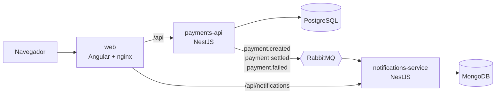

# Payflow

Plataforma de pagamentos de exemplo, construída com **Node.js, TypeScript, NestJS e Angular**. Um usuário cria um pagamento, a API o grava no PostgreSQL e publica um evento no RabbitMQ; um segundo serviço consome o evento e gera uma notificação no MongoDB, que aparece na tela.

O domínio é pequeno de propósito. O objetivo é mostrar, em pouco código, os cuidados que um sistema financeiro exige: idempotência, dinheiro sem ponto flutuante, mensageria com entrega repetida e limites claros entre as camadas.

## Arquitetura



| Pasta | O que é |
| --- | --- |
| `services/payments-api` | API REST de pagamentos: autenticação JWT, regras de negócio, PostgreSQL, publicação de eventos |
| `services/notifications-service` | Consumidor dos eventos: grava notificações no MongoDB e expõe o feed do usuário |
| `web` | Aplicação Angular: login, formulário de pagamento, lista com filtro e feed de notificações |

## Como rodar

Pré-requisito: Docker com Docker Compose.

```bash
cp .env.example .env
docker compose up --build
```

- Aplicação: http://localhost:8080 (usuário `demo@payflow.dev`, senha `payflow-demo`)
- Painel do RabbitMQ: http://localhost:15672 (usuário `payflow`, senha `payflow`)

Se alguma porta já estiver em uso na sua máquina, defina `WEB_PORT` ou `POSTGRES_PORT` no `.env`.

### Desenvolvimento local

Requer Node.js 24. A infraestrutura sobe em containers e cada serviço roda na máquina, com recarga automática:

```bash
docker compose up -d postgres mongo rabbitmq

cd services/payments-api && npm install && npm run start:dev            # porta 3000
cd services/notifications-service && npm install && npm run start:dev   # porta 3002
cd web && npm install && npm start                                      # http://localhost:4200
```

Com a API de pé, a documentação Swagger fica em http://localhost:3000/api/docs.

## API

Todas as rotas, exceto o login e as de saúde, exigem `Authorization: Bearer <token>`.

| Método | Rota | Descrição |
| --- | --- | --- |
| `POST` | `/api/auth/login` | Troca e-mail e senha por um token de acesso |
| `POST` | `/api/payments` | Cria um pagamento. Exige o cabeçalho `Idempotency-Key` |
| `GET` | `/api/payments` | Lista os pagamentos do usuário (`status`, `page`, `limit`) |
| `GET` | `/api/payments/:id` | Consulta um pagamento |
| `POST` | `/api/payments/:id/settle` | Liquida um pagamento pendente |
| `POST` | `/api/payments/:id/fail` | Marca um pagamento pendente como falho, com o motivo |
| `GET` | `/api/notifications` | Notificações do usuário, mais recentes primeiro |
| `GET` | `/api/health/live`, `/api/health/ready` | Sondas de saúde dos dois serviços |

```bash
TOKEN=$(curl -s localhost:8080/api/auth/login -H 'Content-Type: application/json' \
  -d '{"email":"demo@payflow.dev","password":"payflow-demo"}' | jq -r .accessToken)

curl -i localhost:8080/api/payments \
  -H "Authorization: Bearer $TOKEN" \
  -H 'Idempotency-Key: pedido-1042' \
  -H 'Content-Type: application/json' \
  -d '{"payeeKey":"loja@example.com","amountCents":15990,"currency":"BRL"}'
```

Repetir a segunda chamada devolve `200` com o mesmo pagamento, em vez de `201` com um novo.

## Decisões de projeto

**Idempotência na criação.** Em pagamentos, uma requisição repetida (timeout, duplo clique, nova tentativa automática) não pode cobrar duas vezes. O cliente envia um `Idempotency-Key`; repetir a chave devolve o pagamento já criado, e reutilizá-la com outros dados devolve `409`. A garantia final é um índice único em `(payer_id, idempotency_key)`, que resolve também duas requisições simultâneas. O formulário Angular mantém a mesma chave ao reenviar depois de um erro e gera outra quando o usuário altera os dados.

**Dinheiro em centavos inteiros.** Valores trafegam e são gravados como inteiros (`amountCents`), nunca como ponto flutuante. No front, o texto digitado ("159,90") é convertido para centavos sem passar por `float`.

**Camadas com dependências apontando para dentro.** Em `payments-api/src/payments`:

- `domain`: a entidade `Payment` e suas regras (limites, transições de estado), sem dependência de framework;
- `application`: casos de uso e as interfaces (portas) de que eles precisam;
- `infrastructure`: implementações das portas com TypeORM e RabbitMQ;
- `interface`: controllers, DTOs e a tradução de erros de domínio para HTTP.

Isso permite testar as regras e a API HTTP inteira trocando apenas banco e fila por implementações em memória.

**Consumidor idempotente.** O RabbitMQ entrega cada mensagem pelo menos uma vez, então ela pode chegar repetida. Cada evento tem um `eventId`, e o MongoDB tem um índice único nele: a segunda entrega é reconhecida e ignorada. A mensagem só é confirmada (`ack`) depois de gravada; se o banco falhar, ela volta para a fila. Mensagens malformadas são registradas em log e descartadas, porque tentar de novo nunca daria certo.

**Segurança.** Validação estrita da entrada (campos desconhecidos são rejeitados), limite de tentativas no login, cabeçalhos de segurança com Helmet, containers rodando sem root, segredos apenas por variável de ambiente e falha na inicialização se o segredo do JWT for curto. Um pagamento de outro usuário responde `404`, sem revelar que existe.

## Testes

```bash
cd services/payments-api && npm test            # 26 testes: domínio, casos de uso e API HTTP
cd services/notifications-service && npm test   # 15 testes: tratamento de eventos e consumidor
cd web && npm test                              # 24 testes: conversão de valores, interceptor e formulário
```

Os testes HTTP da `payments-api` exercitam controllers, guards, validação e casos de uso reais com Supertest. O pipeline de CI (`.github/workflows/ci.yml`) roda lint, checagem de tipos, testes e build de cada projeto, e depois constrói as imagens Docker.

## Limitações conhecidas

São simplificações conscientes de um projeto de demonstração:

- **Publicação de eventos não é transacional.** O pagamento é gravado e o evento é publicado em seguida; se o broker estiver fora do ar nesse intervalo, o evento se perde (o pagamento não). A solução é o padrão *transactional outbox*: gravar o evento na mesma transação e publicá-lo por um processo separado.
- **Autenticação de demonstração.** Há um único usuário, definido por variável de ambiente, e os dois serviços compartilham um segredo HS256. Em produção, a autenticação seria delegada a um provedor OAuth 2.0 / OpenID Connect, com chaves assimétricas.
- **Liquidação manual.** Os botões "Liquidar" e "Recusar" simulam a resposta de um processador de pagamentos, que em um sistema real chegaria por webhook ou evento.
- **Sem testes contra banco e fila reais na suíte automatizada.** Os repositórios TypeORM e Mongoose foram verificados manualmente com o ambiente completo, mas não há testes de integração com Testcontainers.
- **Notificações por polling.** A tela consulta o feed a cada 5 segundos; WebSocket ou SSE evitaria as consultas vazias.

## Tecnologias

Node.js 24 · TypeScript · NestJS 12 · TypeORM · PostgreSQL · Mongoose · MongoDB · RabbitMQ · Angular 22 · RxJS · Jest · Vitest · Docker · GitHub Actions
